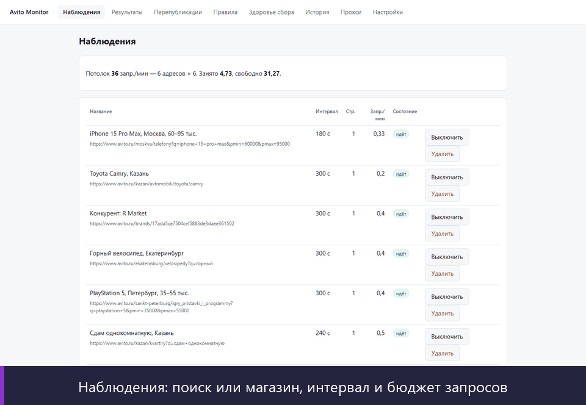
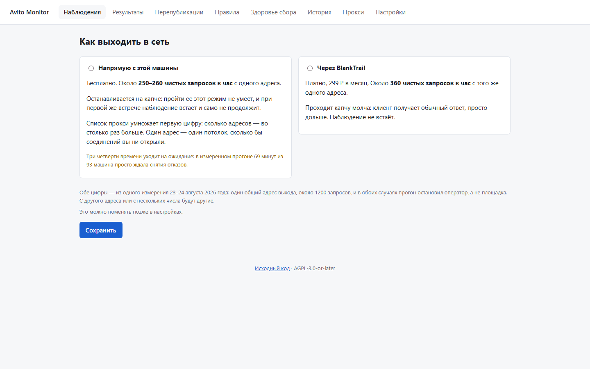
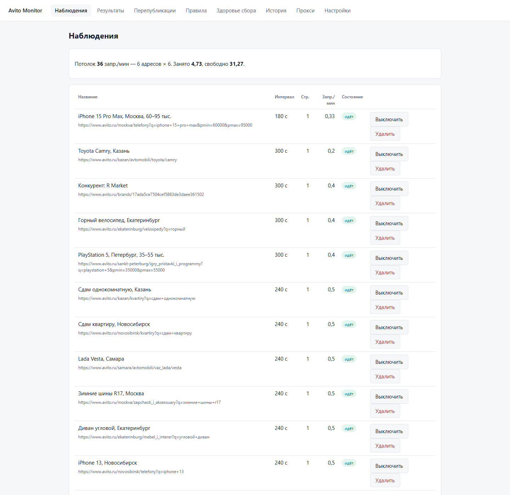
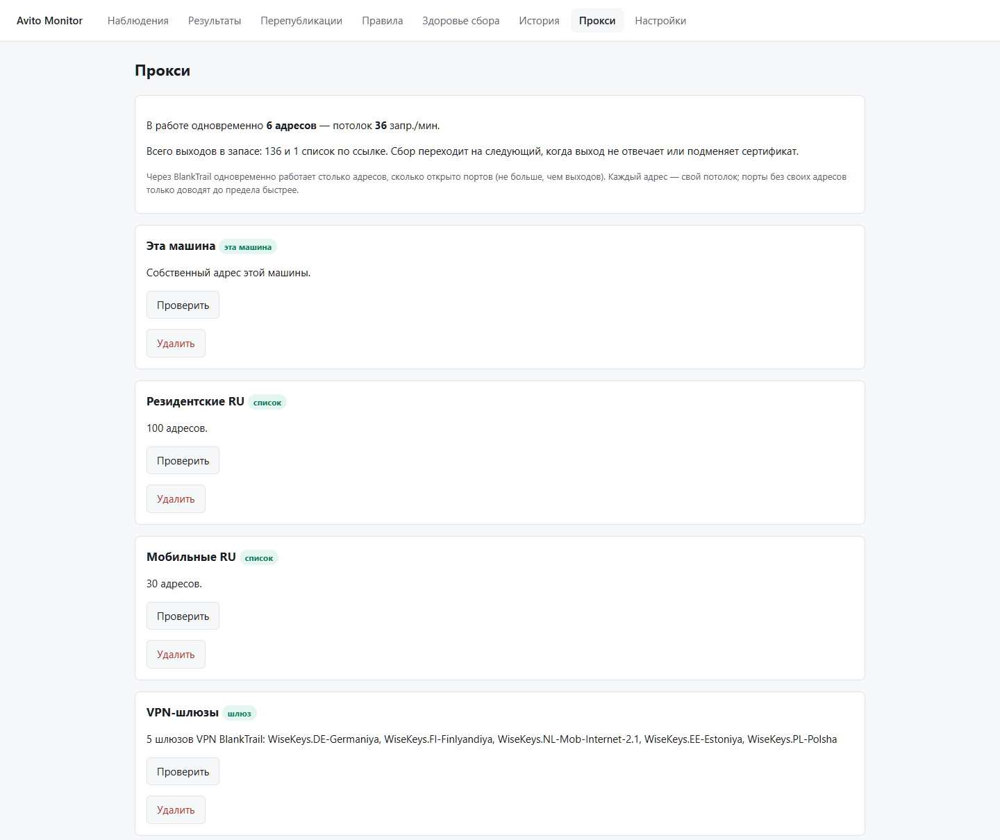
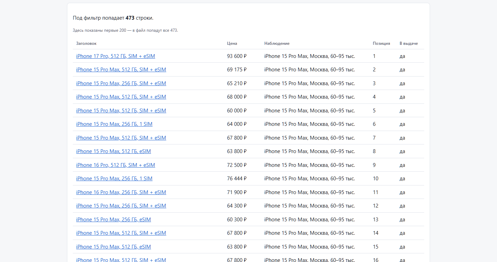
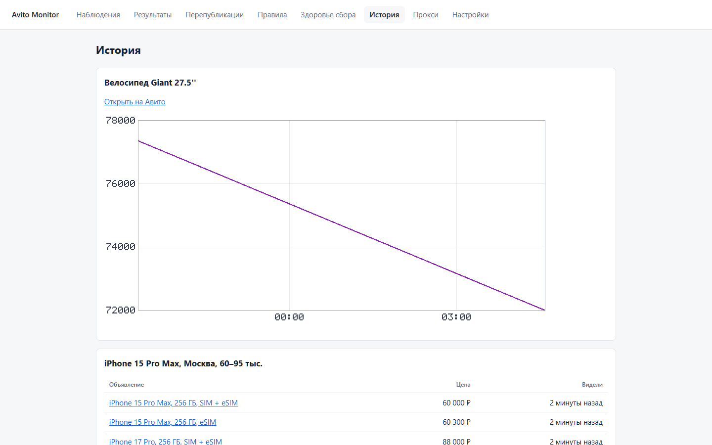
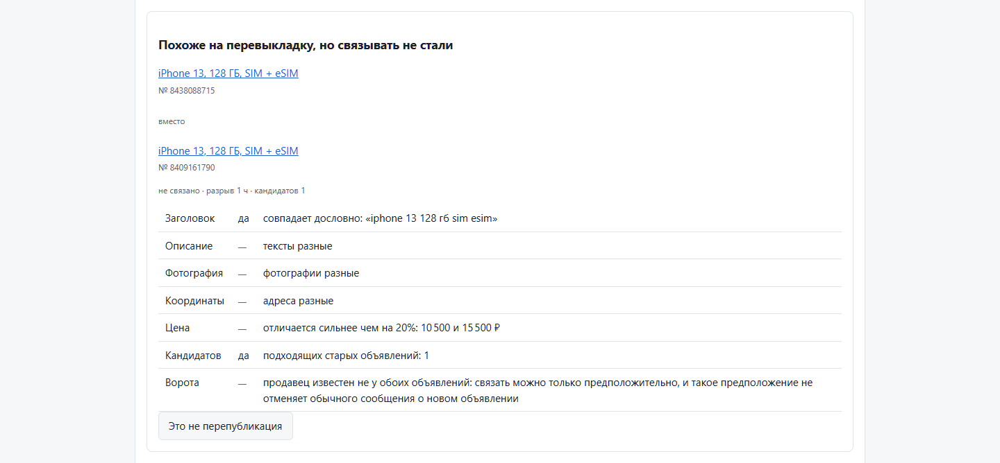
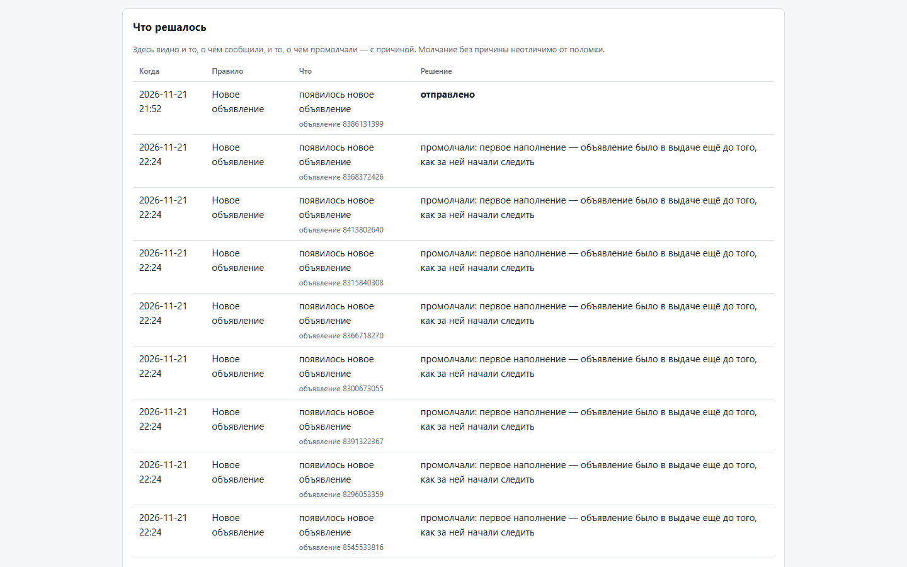
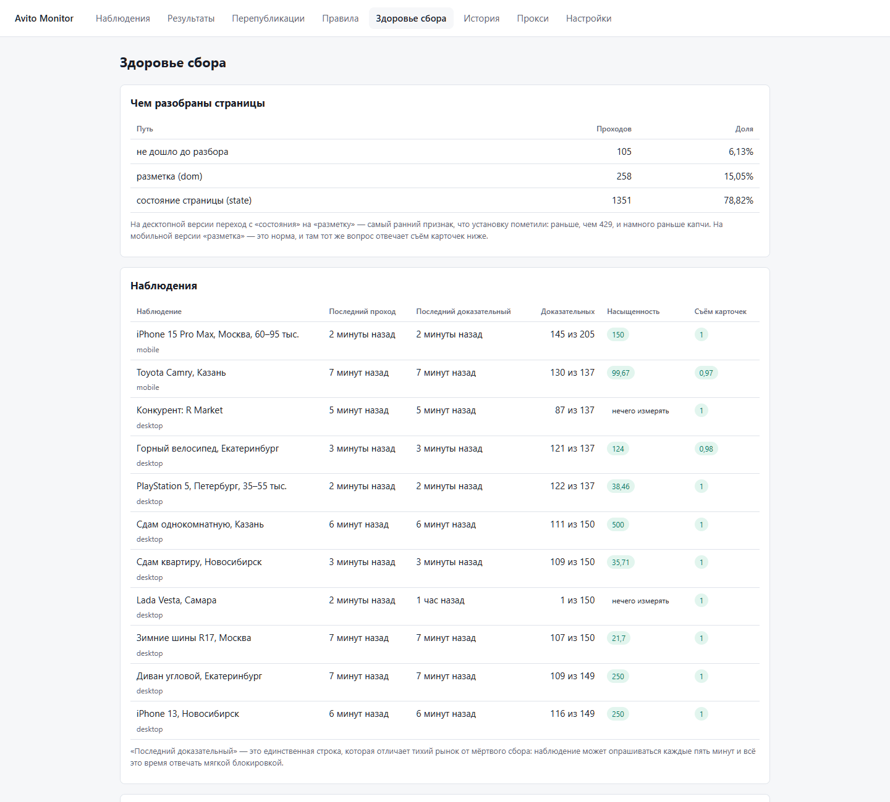

<div align="center">

# Avito Monitor от BlankTrail — мониторинг объявлений Авито, цен и конкурентов

**Новые объявления, изменения цен и магазины конкурентов — без ручных проверок.**

**Avito Monitor** по расписанию читает выдачу Авито и страницы магазинов,<br>
хранит историю у вас и присылает в Telegram только то, что изменилось.

[](https://github.com/BlankTrail/avito-monitor/releases/latest/download/avitomon-windows-amd64.zip)
[](https://github.com/BlankTrail/avito-monitor/releases/latest)
[](LICENSE)

**Выдача по поиску · Магазины конкурентов · История цен · Перепубликации · Telegram · CSV / XLSX / JSON**

</div>

> **Без входа в аккаунт Авито.** Монитор читает только то, что Авито показывает любому посетителю. Не нужны логин, пароль, API-ключи Авито или доступ к личному кабинету. Данные и настройки лежат в одном файле SQLite на вашем компьютере или сервере.

> **Работает напрямую или через [BlankTrail Proxy](https://blanktrail.com).** Напрямую — бесплатно, но на капче наблюдение останавливается и ждёт вас. Через BlankTrail капча проходится сама, а десктопная версия сайта с продавцом и фотографиями становится доступна. [Чем отличаются режимы →](#напрямую-или-через-blanktrail)



<p align="center"><sub>GIF собран из скриншотов настоящей панели после восьмичасового прогона на живом Авито. Объявления и цены в кадре — то, что тогда было в выдаче; GIF не показывает скорость работы.</sub></p>

<p align="center">
<a href="#что-умеет-монитор">Возможности</a> ·
<a href="#быстрый-старт">Быстрый старт</a> ·
<a href="#первое-наблюдение">Первое наблюдение</a> ·
<a href="#напрямую-или-через-blanktrail">Режимы</a> ·
<a href="#прокси-и-выходы">Прокси</a> ·
<a href="#уведомления-в-telegram">Telegram</a> ·
<a href="#вопросы-перед-запуском">Вопросы</a>
</p>

## Что умеет монитор

| Ваша задача | Что делает программа | Где смотреть |
|---|---|---|
| **Первым видеть новые объявления** | Опрашивает выдачу по вашей ссылке и сообщает о каждом новом объявлении | **Наблюдения**, Telegram |
| **Следить за ценами** | Пишет каждое изменение цены и рисует график по всей жизни объявления | **История**, **Результаты** |
| **Следить за конкурентом** | Наблюдает магазин целиком по ссылке `avito.ru/brands/…` | **Наблюдения** |
| **Не путаться в перевыкладках** | Находит объявление, выложенное заново под новым номером, и показывает, на каком основании связал | **Перепубликации** |
| **Знать, что ушло с рынка** | Отмечает пропавшие и снятые объявления, подтверждая пропажу двумя проходами | **Результаты**, Telegram |
| **Отдать данные в Excel или скрипт** | Выгружает выбранные колонки в CSV, XLSX, JSON или JSONL | **Результаты → Выгрузить** |
| **Понимать, что сбор жив** | Показывает, чем разобрана каждая страница, что отвечал сайт и когда был последний доказательный проход | **Здоровье сбора**, `/healthz` |

**Всё работает у вас.** Веб-панель открывается в браузере и по умолчанию доступна только с этой машины. Telegram подключается по желанию. Кроме Авито, Telegram и BlankTrail программа никуда не обращается и статистику не отправляет.

<a id="быстрый-старт"></a>

## Быстрый старт

Готовые сборки не требуют ни Go, ни компилятора, ни установки.

### 1. Скачайте программу

| Ваша система | Архив |
|---|---|
| **Windows, обычный ПК** | **[avitomon-windows-amd64.zip](https://github.com/BlankTrail/avito-monitor/releases/latest/download/avitomon-windows-amd64.zip)** |
| Windows на ARM | [avitomon-windows-arm64.zip](https://github.com/BlankTrail/avito-monitor/releases/latest/download/avitomon-windows-arm64.zip) |
| Linux, обычный ПК или сервер | [avitomon-linux-amd64.tar.gz](https://github.com/BlankTrail/avito-monitor/releases/latest/download/avitomon-linux-amd64.tar.gz) |
| Linux на ARM | [avitomon-linux-arm64.tar.gz](https://github.com/BlankTrail/avito-monitor/releases/latest/download/avitomon-linux-arm64.tar.gz) |
| Mac с Apple silicon (M1 и новее) | [avitomon-macos-apple-silicon.tar.gz](https://github.com/BlankTrail/avito-monitor/releases/latest/download/avitomon-macos-apple-silicon.tar.gz) |
| Mac с процессором Intel | [avitomon-macos-intel.tar.gz](https://github.com/BlankTrail/avito-monitor/releases/latest/download/avitomon-macos-intel.tar.gz) |

[Все версии](https://github.com/BlankTrail/avito-monitor/releases) · [Контрольные суммы SHA256](https://github.com/BlankTrail/avito-monitor/releases/latest/download/SHA256SUMS.txt)

### 2. Запустите панель

**Windows:** распакуйте архив в отдельную папку и дважды щёлкните `avitomon-tray.exe`. Чёрного окна не будет: в области уведомлений появится значок, его меню — «Открыть панель» и «Выход». `avitomon.exe` должен лежать рядом: значок запускает именно его.

**Linux / macOS:** распакуйте архив и выполните `./start.sh` (или `./avitomon panel`). На macOS при первом запуске может понадобиться разрешить программу в «Системных настройках → Конфиденциальность и безопасность».

Панель: **[http://127.0.0.1:8765](http://127.0.0.1:8765)**. База — файл `avito.db` рядом с программой; другой файл и порт задаются флагами `-db` и `-port`. Сбор идёт в том же процессе, что и панель.

<details>
<summary>Собрать из исходников</summary>

Нужен **Go 1.26** или новее; компилятор C не нужен, SQLite написана на чистом Go.

```bash
git clone https://github.com/BlankTrail/avito-monitor.git
cd avito-monitor
go build -o avitomon ./cmd/avitomon
```

Значок для Windows: `go build -ldflags=-H=windowsgui -o avitomon-tray.exe ./cmd/avitomon-tray`.

</details>

### 3. Выберите, как выходить в сеть

Пока способ не выбран, сбор не начинается. Панель сама откроет этот выбор при первом запуске:



Для режима BlankTrail откройте **Настройки**, впишите адрес управления (обычно `http://127.0.0.1:8891`), ключ BlankTrail и число портов, затем нажмите **Проверить**.

### 4. Добавьте наблюдение

Откройте нужный поиск на avito.ru, настройте фильтры как обычно и скопируйте ссылку из адресной строки. Дальше — в следующем разделе.

<a id="первое-наблюдение"></a>

## Первое наблюдение



1. Откройте **Наблюдения → Добавить наблюдение**.
2. **Название** — как наблюдение будет называться в сообщениях, например «PlayStation 5, Петербург, 35–55 тыс.».
3. **Ссылка на поиск или магазин** — ссылка из адресной строки Авито. Цена `pmin`/`pmax`, запрос, район, метро и радиус сохраняются; сортировка всегда «сначала новые».
4. **Интервал, секунды** — не меньше 120: чаще минуты Авито отдаёт ту же выдачу, и запросы тратятся впустую.
5. **Страниц за проход** — 1 или 2. Третья страница — самый заметный для площадки сигнал, поэтому её монитор не берёт.
6. **Версия сайта**:
   - **мобильная** — один запрос на страницу, 30 объявлений, без продавца;
   - **десктопная** — два запроса на страницу, 50 объявлений, с продавцом, координатами и фотографиями. Перевыкладки связываются только на ней.
7. Нажмите **Добавить**. Первый проход «засевает» наблюдение: то, что уже было в выдаче, не считается новым и не приходит в Telegram.

**Бюджет запросов виден сразу.** Над списком написано, сколько запросов в минуту разрешено и сколько уже занято. Расписание, которое не помещается, панель не примет и покажет расчёт. Если под запрос попадает больше пяти тысяч объявлений, панель предложит сузить его ценой: верхушка такой выдачи меняется быстрее, чем её можно прочитать.

**Магазин** добавляется ссылкой `https://www.avito.ru/brands/…`: страница магазина стоит один запрос, и версия сайта выбирается сама. Частных продавцов (`/user/…`) эта версия не отслеживает.

<a id="напрямую-или-через-blanktrail"></a>

## Напрямую или через BlankTrail

| | Напрямую с этой машины | Через BlankTrail Proxy |
|---|---|---|
| **Стоимость** | Бесплатно | Подписка BlankTrail |
| **Чистых запросов в час с одного адреса** | около 250–260 | около 360 |
| **Капча** | Наблюдение останавливается и ждёт кнопку «Возобновить» | Проходится автоматически, сбор не встаёт |
| **Десктопная версия с продавцом** | Встаёт на капче с первого запроса | Работает |
| **Перепубликации** | Не связываются: в мобильной выдаче нет продавца | Связываются |
| **Шлюзы VPN BlankTrail** | Недоступны | Доступны |

Цифры — из замера 23–24 августа 2026 года: один адрес, около 1200 запросов, мобильная выдача. В прямом режиме 69 минут из 93 ушли на пережидание отказов. Подробности — в [docs/measurements/2026-08-23-soak.md](docs/measurements/2026-08-23-soak.md).

**Потолок считается на адрес, а не на соединение.** Один адрес — 6 запросов в минуту, сколько бы портов ни было открыто. Больше адресов дают больше запросов: список из 100 прокси или 6 портов BlankTrail на разных выходах поднимают потолок во столько же раз. В настройках «Запросов в минуту на адрес» можно поставить и больше 6, но действовать будет меньшее из двух.

<a id="прокси-и-выходы"></a>

## Прокси и выходы



На вкладке **Прокси** собираются выходы, через которые монитор ходит на Авито.

| Вид выхода | Как задаётся | Для чего |
|---|---|---|
| **Собственный адрес этой машины** | Ничего настраивать не нужно | Начать без прокси |
| **Список адресов** | По одному в строке: `схема://логин:пароль@адрес:порт`, без схемы — socks5. Или ссылка на список (http(s) или путь к файлу), которая перечитывается раз в час | Свои прокси или список провайдера |
| **Ротация по ссылке** | Один адрес и ссылка смены адреса | Мобильные прокси со сменой IP по запросу |
| **Шлюзы VPN BlankTrail** | Конфигурации загружаются в BlankTrail Proxy, в мониторе отмечаются галочками | VPN-подписки, только в режиме BlankTrail |

У резидентских прокси с сессией в логине каждая строка — своя сессия, а значит свой адрес выхода: впишите одну и ту же учётку с разными номерами сессии.

**Кнопка «Проверить»** открывает TLS-соединение с Авито через выборку до 20 адресов и показывает, сколько ответили с настоящим сертификатом, сколько промолчали и сколько **подменяют сертификат**. Через выход с подменой сбор не пойдёт: такой прокси видит всё, что монитор получает и отправляет. Сбор сам переходит на следующий выход, если текущий не отвечает или подменяет сертификат.

Пароли прокси в сообщениях панели заменяются на `<пароль>`.

## Результаты и выгрузка



**Что показывать:** одно наблюдение или все, поиск по заголовку, цена от и до, срок (сутки, неделя, месяц, всё время) и галочка «Только те, что сейчас в выдаче» — снимите её, чтобы увидеть пропавшие. В таблице показываются первые 200 строк, в файл попадают все.

**Выгрузить:** отметьте нужные колонки или ничего — тогда выгрузятся все.

| Формат | Когда нужен |
|---|---|
| **CSV** | Таблица для чего угодно. Галочка «Настроить CSV под русский Excel» ставит точку с запятой, запятую в дробях и метку кодировки |
| **XLSX** | Открыть в Excel двойным щелчком |
| **JSON** | Один массив — для программы |
| **JSONL** | По объекту на строку — для конвейера |

Колонки: номер объявления, сквозной номер (общий для всех перевыкладок), заголовок, ссылка, цена, что с ценой, скидка, продавец, наблюдение, позиция в выдаче, сейчас в выдаче, когда впервые и в последний раз видели, продвигается ли и забронировано ли.

## История цен и перепубликации



**История** показывает объявления по наблюдениям и график цены каждого. График сшит по всем номерам, под которыми объявление выкладывалось, и появляется, когда есть хотя бы две цены. Снимки старше месяца прореживаются до дневных, старше года — до недельных.



**Перепубликации** — продавец снял объявление и выложил его заново под новым номером. Монитор связывает такие объявления, чтобы история цены не начиналась с нуля, а «новое объявление» не приходило в Telegram ещё раз. На экране видно каждое основание: совпадает ли заголовок, описание, фотография, адрес, отличается ли цена больше чем на 20%. Сначала проверяются ворота: тот же продавец, та же категория, старое объявление пропало, а не висит рядом, окно — 30 дней.

Связь ничего не склеивает. Кнопка **«Это не перепубликация»** снимает её, разделяет историю и запрещает связывать эту пару в будущем. Связывание работает на десктопной версии: в мобильной выдаче нет продавца.

<a id="уведомления-в-telegram"></a>

## Уведомления в Telegram

1. Создайте бота у [@BotFather](https://t.me/BotFather) и вставьте токен в **Настройки → Телеграм**. Кнопка **Проверить** ответит именем бота.
2. Добавьте бота в нужный чат, а на вкладке **Правила → Получатели** впишите числовой id этого чата.
3. При первом получателе монитор сам создаст правила для каждого наблюдения: **новое объявление**, **изменилась цена** (от 1% и от 100 ₽), **объявление пропало**, **объявление закрыто** — и пять служебных: сайт перестал отвечать, разметка изменилась, сбор молчит и другие.

**Правило можно настроить.** О чём сообщать — новые, вернувшиеся, пропавшие, снятые, перевыложенные объявления, изменение цены, скидки, заголовка, продвижения или брони. Пороги в процентах и рублях, «не чаще чем раз в N минут», тихие часы и «срочно» — пробивает тихие часы. Условие собирается из сравнений через «и»: изменение в процентах или рублях, было, стало, позиция в выдаче, наблюдение, продавец. Следить можно за всем под фильтром, за наблюдением, одним объявлением с его перевыкладками или одним продавцом.

**Сорок изменений — одно сообщение.** Новые и пропавшие объявления по умолчанию собираются в одно сообщение за проход: «Новое объявление: 40 изменений», пять примеров и «… и ещё 35». Одно изменение приходит обычным сообщением.



**Видно и то, о чём промолчали.** Журнал «Что решалось» показывает каждое решение с причиной: первое наполнение, перевыкладка, меньше порога, уже сообщали, слишком часто, тихие часы. Молчание без причины не отличить от поломки, поэтому причина есть всегда.

Проверка связи из командной строки: `avitomon notify -test -chat <id чата>`.

## Здоровье сбора



За последние сутки:

- **Чем разобраны страницы** — состоянием страницы, разметкой или не дошло до разбора. На десктопной версии переход на разметку — самый ранний признак того, что адрес пометили.
- **Наблюдения** — последний проход и последний **доказательный** проход. Только он отличает тихий рынок от сбора, который пять минут подряд упирается в мягкую блокировку.
- **Что отвечала площадка** по часам: в порядке, пусто, мягкая блокировка, притормозили, капча, личность сожжена и другие классы.
- **База** — размер файла и строки по таблицам.

Если наблюдение остановилось, баннер над каждым экраном скажет, какое, почему и когда. Автоповтора на капче в прямом режиме нет: каждое возобновление — это один запрос, и делает его человек.

<a id="работа-на-сервере"></a>

## Работа на сервере

- **Автозапуск на своей машине:** галочка **Настройки → Панель → Запускать при входе в систему**. На Windows это запись в реестре пользователя, на macOS — `LaunchAgent`, на Linux — пользовательский юнит systemd. Прав администратора не нужно; в записи сохраняются полный путь к базе и порт.
- **Сервер без входа пользователей:** готовые `avitomon.service` для systemd и `com.blanktrail.avitomon.plist` для launchd с инструкцией — в [deploy/](deploy/README.md).
- **Доступ к панели:** по умолчанию она слушает только `127.0.0.1`. Откройте её для сети галочкой в настройках — только после того, как задали пароль. Или пробросьте порт: `ssh -N -L 8765:127.0.0.1:8765 <сервер>`.
- **Мониторинг:** `GET /healthz` без пароля отвечает `200 ok: собирает X из Y` или `503`, если все наблюдения остановлены или сбор не запущен. Перезапуск при 503 не поможет — нужен человек.

## Командная строка

Всё, что делает панель, можно сделать и без неё.

| Команда | Что делает |
|---|---|
| `avitomon panel [-db avito.db] [-port 8765] [-no-collect]` | Панель и сбор в одном процессе |
| `avitomon watch add -name <имя> -surface mobile\|desktop -interval 300 <ссылка>` | Добавить наблюдение |
| `avitomon watch resume <id> \| --all` | Снять остановку после капчи |
| `avitomon run --once` | Один проход одного наблюдения, которому пора, — для проверки |
| `avitomon changes [-watch 1] [-since 24h]` | Изменения за период |
| `avitomon enrich [-limit 20]` | Дочитать продавца и описание для объявлений с мобильной выдачи |
| `avitomon target add -name <имя> <id чата>` | Добавить получателя |
| `avitomon notify -test -chat <id>` | Тестовое сообщение в Telegram |
| `avitomon transport show \| set direct\|blanktrail` | Способ выхода в сеть |
| `avitomon fetch [-mode direct\|blanktrail] <ссылка>` | Скачать одну страницу и показать разбор |

Ключ BlankTrail можно передать через переменную `AVITOMON_BLANKTRAIL_KEY`, токен бота — через `AVITOMON_TELEGRAM_TOKEN`.

## Хранение и приватность

- **Один файл SQLite.** Объявления, снимки цен, проходы и настройки — в `avito.db`. Ответы сайта хранятся 30 дней и не больше 500 МБ; оба числа меняются в настройках. Сбор останавливается раньше, чем кончится место на диске: порог задаётся в настройках, и действует большее из него и 2% тома.
- **Ключи не утекают в логи.** Ключ BlankTrail и токен бота не пишутся в логи и вырезаются из сообщений об ошибках. Пароль панели хранится только как хэш PBKDF2.
- **Порты BlankTrail подписаны.** Монитор помечает порты, которые открыл, и при следующем запуске закрывает оставшиеся от прошлого — чужие порты не трогает.

## Вопросы перед запуском

**Нужен ли BlankTrail?** Нет. Прямой режим бесплатен и работает с мобильной выдачей. BlankTrail нужен, чтобы капча не останавливала наблюдения, чтобы читать десктопную версию с продавцом и чтобы связывать перевыкладки.

**Нужно ли держать браузер открытым?** Нет. Сбор идёт в программе. Вкладку можно закрыть — работать должен только `avitomon`.

**Почему наблюдение остановилось?** В прямом режиме — капча: Авито спросил её, а пройти её этот режим не умеет. Баннер скажет, какое наблюдение и когда. Нажмите «Возобновить» или включите BlankTrail. Если капча повторяется, добавьте прокси на вкладке «Прокси».

**Почему не пришло сообщение о новом объявлении?** Откройте «Правила → Что решалось»: там написана причина. Чаще всего это первое наполнение — объявление было в выдаче ещё до начала наблюдения — или перевыкладка, о которой уже сообщали.

**Почему так мало запросов?** Потолок — 6 запросов в минуту на адрес, измеренный на живом Авито. Больше адресов — выше потолок. Ставить больше на одном адресе бессмысленно: площадка ответит блокировкой.

## Для разработчиков

Написано на **Go** без cgo: SQLite — `modernc.org/sqlite`, TLS-отпечаток браузера — `utls`, Telegram — Bot API.

```bash
make check   # gofmt, go vet, тесты и проверка, что разбор страниц не ходит в сеть
go test ./...
```

Пакет `avito/` разбирает страницы и не может ничего скачать: это проверяют тесты, поэтому записанные страницы из `avito/testdata` и живые читаются одним и тем же кодом. Замеры, на которых держатся цифры в панели и в этом README, — в [docs/measurements/](docs/measurements/). Скриншоты для README лежат в `docs/img/`; GIF пересобирается командой `python docs/media/build_readme_gif.py` (нужен Pillow).

Ошибки и пожелания — в [GitHub Issues](https://github.com/BlankTrail/avito-monitor/issues). Не прикладывайте ключи, токены и пароли прокси.

## Лицензия

[GNU AGPL-3.0-or-later](LICENSE). Происхождение заимствованного кода — в [NOTICE](NOTICE).

---

**[Исходный код](https://github.com/BlankTrail/avito-monitor) · [Замеры](docs/measurements/) · [Запуск на сервере](deploy/README.md) · [BlankTrail Proxy](https://blanktrail.com)**
