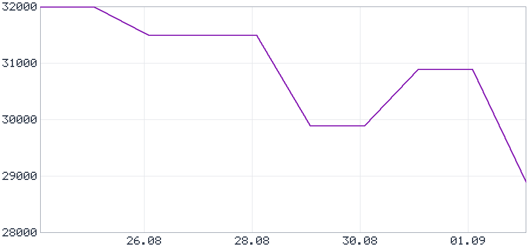

# Картинки, которых никто не видел

6 сентября 2026. График цены как PNG, экран перепубликаций с данными,
`make check`.

## График цены был пуст

Первый же отрисованный PNG: оси, сетка и подписи верные — диапазон
42000–52000 накрывает синтетические 43990–50990, даты 26.08–03.09 накрывают
ряд, — а линии нет вовсе. Ни одного пикселя.

Причина в `chartMaxGap = 6 * 60 * 60` с комментарием, который сам же назвал
факт, её опровергающий:

> Шесть часов… комфортно больше любого интервала наблюдения и **много
> меньше прореживания, оставляющего один снимок в день**.

Интервал наблюдения тут ни при чём. Снимок пишется, когда сдвинулся
отпечаток, **плюс один якорь каждые `Retention.AnchorEvery`** — сутки по
умолчанию. У телефона, чья цена держалась неделю, семь показаний в сутках
друг от друга: каждая пара дальше шести часов, каждая пара отвергнута,
график пуст. Не после прореживания — сразу, на свежих данных.

`TestTheChartIsAPng` не мог это поймать: его два снимка стоят **в часе**
друг от друга — каденция, которой хранилище не производит никогда.

Величина теперь выводится из частоты записи: якорный интервал плюс
четверть. Ниже неё пропущенное показание значит, что строку должны были
написать и не написали, — настоящее молчание. Выше — отличить молчание от
самой каденции нечем.



Новый тест считает пиксели цвета линии при настоящей каденции. На старом
значении он даёт **ровно ноль** — проверено возвратом дефекта. Второй тест
требует, чтобы двухнедельное молчание линию по-прежнему рвало: починка не
должна была свестись к «соединять всё».

Оставшаяся дыра названа на экране там, где видна: за год прореживание
оставляет один снимок в неделю, линия рвётся над тем, что смотрели, и
строки, которые доказали бы обратное, удалены намеренно.

## Обе стороны перепубликации читались одинаково

Экран наполнился правильно: вердикт фразой, основание словами, разрыв,
кандидаты, таблица признаков, отличающая «не совпало» от «не было», кнопка
отмены. Всё, кроме различимости сторон:

```
iPhone 13 Pro, 256 ГБ, SIM + eSIM
вместо
iPhone 13 Pro, 256 ГБ, SIM + eSIM
```

У перепубликации заголовок одинаковый по определению — на этом она и
опознаётся. Номера, предмет всей затеи («одно объявление под новым
номером»), были единственным, чего на карточке не было.

## make check был красным

`make check-no-net` запрещал `avito/` импортировать `net/url`. Запрет сняли
в тестах пакета — `SearchURL` его требует, — но не в Makefile. Цель падала
на `avito/searchurl.go`, `go test ./...` при этом был зелёным.

Никто не видел, потому что запустить нечем: `make` на машине, где всё это
писалось, не установлен. Расхождение теперь проверяет тест, который
запускают все, и он проверен на живом дефекте.

## Что из этого следует

Третий заход подряд с одним и тем же исходом, и это уже закономерность, а
не наблюдение: **проверяется вычисленное, а не показанное**. График,
рисующий оси по данным и не рисующий данные. Карточка, показывающая одну
строку дважды. Цель сборки, красная год.

Тест, который смотрит на выход как на выход — пиксели, номера, список из
Makefile, — ловит всё это первым же прогоном. Тест, который смотрит на тип
выхода («это PNG», «код 200»), не поймает никогда.
